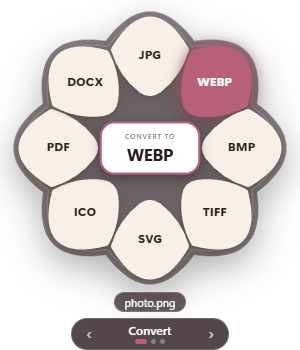
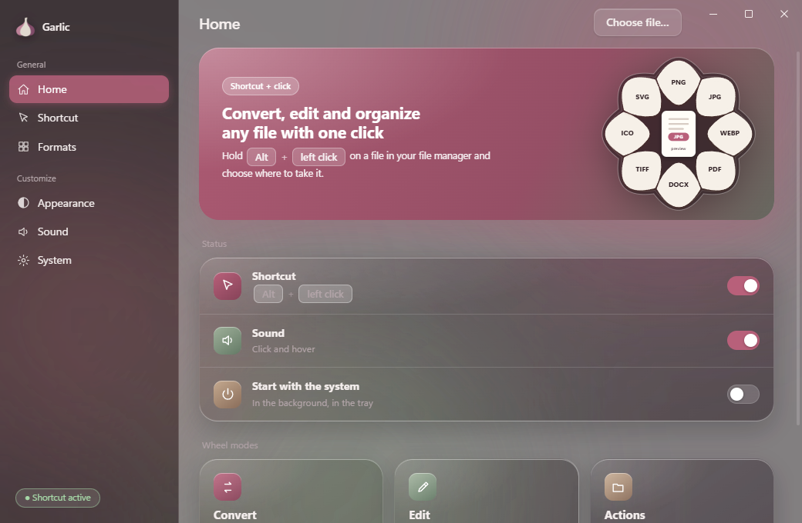
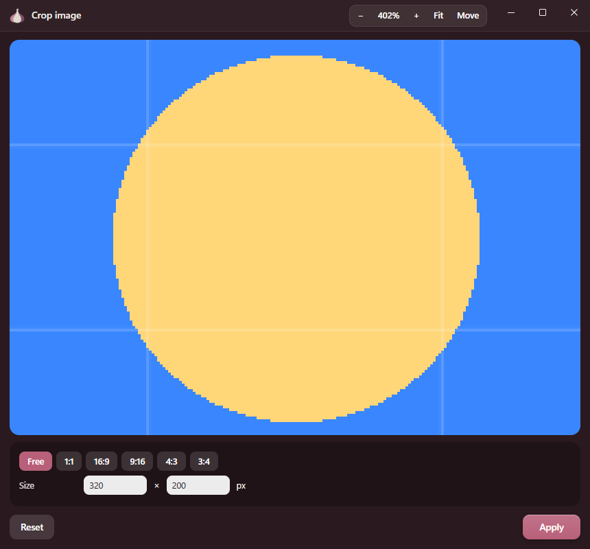
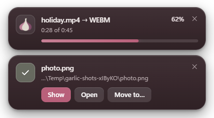

<div align="center">


# Garlic

**Convert, edit and organise files from a small wheel that pops up next to any file.**

Hold a key, click a file, and pick the format to convert it to, the tool to use or what to do with it.

English · [Español](README.md) · [Website](https://sltcrd.github.io/garlic/)



</div>

> **Status:** [latest release](https://github.com/Sltcrd/garlic/releases/latest) · tested on **Windows 10/11**. macOS is implemented but **untested**, and Linux works **without the click shortcut** (see [Platform support](#platform-support)).
> Garlic is an independent app inspired by the idea of [Tangerine for Mac](https://tangerineformac.com/); it is unaffiliated and shares no code or design with it.

---

## Contents

- [What it does](#what-it-does)
- [How to use it](#how-to-use-it)
- [Installation](#installation) — portable zip · from source (CMD / PowerShell / Bash) · portable folder · command line
- [Platform support](#platform-support)
- [Formats](#formats)
- [Settings and customisation](#settings-and-customisation)
- [Privacy and security](#privacy-and-security)
- [Project structure](#project-structure)
- [Development](#development)
- [Troubleshooting](#troubleshooting)
- [Known limitations](#known-limitations)
- [License and credits](#license-and-credits)

## What it does

| | |
|---|---|
| **Convert** | 60+ conversions: images, PDF, Word, PowerPoint, Markdown, HTML, EPUB, spreadsheets, subtitles, audio, video and archives. PDFs made from Markdown/HTML/Word/PowerPoint are rendered by Chromium, so images, tables, colours and layout are kept. |
| **Edit** | Images: crop, remove background (automatic, magic wand, eraser), add background, compress, adjust, redact, annotate, view metadata. Audio: compress, normalise, channels, trim, waveform. Video: compress, trim, crop, speed, mute, capture frame, split. |
| **Actions** | For *any* file or folder: copy path, reveal, open, terminal here, copy or move to… Folders can be packed to ZIP/TAR/TGZ. |
| **Progress** | A floating card shows a bar and percentage (real for audio/video) and, when done, lets you **Show**, **Open** or **Move to…** the new file. |
| **Editor** | Its own window: movable, resizable and **zoomable** (Ctrl + wheel, buttons, Ctrl +/−/0/1), with panning (wheel, middle button, space bar). |
| **Interface** | English and Spanish, dark/light/auto theme, glass effect, adjustable accent and opacity, optional sounds. |

<p align="center"></p>

## How to use it

1. Start Garlic. It lives in the **system tray**.
2. In your file manager hold **Alt** and **left-click** a file (change the combination under *Shortcut*).
3. The wheel appears next to the file. Hover to see what an option does ("convert to PNG") and click.
4. Switch mode with **‹ ›**, the arrow keys or the mouse wheel: **Convert → Edit → Actions**.
5. Close the wheel by clicking outside, pressing **Esc**, or leaving it idle for a few seconds.

You can also drop a file on the window, use **Choose file…**, or open one from the command line (`garlic file.pdf`).

<div align="center">
  <video src="https://github.com/user-attachments/assets/1d1ce855-d81c-4116-8478-6c83d8107a81" width="640" controls muted></video>
</div>

<p align="center">&nbsp;</p>

## Installation

### Requirements

- **Node.js 20.19 or newer** and **pnpm 11** (only for options B, C and D; not needed for the zip in Option A) — <https://nodejs.org>. Install pnpm with `npm install -g pnpm` (or `corepack enable`).
- Internet access **while installing** (Electron and ffmpeg are downloaded); it works offline afterwards.
- Windows 10/11 (see [platform support](#platform-support) for other systems).

### Option A — Download the portable zip (Windows, no Node.js needed)

1. Open the repository's **Releases** page: <https://github.com/Sltcrd/garlic/releases/latest>
2. Download **`Garlic-win32-x64.zip`** (under *Assets*).
3. Right-click the zip → **Properties** → tick **Unblock** → OK (so Windows does not flag the files as downloaded from the internet).
4. **Extract everything** to a folder, e.g. `C:Garlic` (don't run it from inside the zip).
5. Double-click **`Garlic.vbs`** (or `Garlic.bat`). Garlic appears in the system tray.

> **Windows shows "Windows protected your PC" (SmartScreen):** click *More info → Run anyway*. This happens because the program is not signed with a paid certificate, not because it is dangerous; the whole source is public and you can build it yourself (Option B). If Smart App Control blocks the `.exe`, use Option B.
>
> **Licenses:** the zip includes ffmpeg (GPL). Its source: <https://ffmpeg.org> and <https://github.com/eugeneware/ffmpeg-static>. More in `THIRD_PARTY_NOTICES.md`.

### Option B — From source

**CMD**

```bat
git clone https://github.com/Sltcrd/garlic.git
cd garlic
pnpm install --frozen-lockfile
pnpm start
```

**PowerShell**

```powershell
git clone https://github.com/Sltcrd/garlic.git
Set-Location garlic
pnpm install --frozen-lockfile
pnpm start
```

**Bash (macOS / Linux / Git Bash)**

```bash
git clone https://github.com/Sltcrd/garlic.git
cd garlic
pnpm install --frozen-lockfile
pnpm start
```

`pnpm install --frozen-lockfile` installs **exactly** the versions in `pnpm-lock.yaml` (≈ 600 MB) and runs no dependency scripts except those of three approved packages (ffmpeg and the click hook); see [Dependencies and supply chain](SECURITY.md#dependencies-and-supply-chain). Electron is downloaded the first time you start it; if that fails, run `node node_modules/electron/install.js` and then `pnpm start` again.

To start **hidden in the tray**: `pnpm run start:hidden`.

### Option C — Build your own portable folder (optional)

```bash
pnpm install --frozen-lockfile
pnpm run package          # creates out/Garlic-<platform>-<arch>/
pnpm run package:zip      # also creates the .zip
```

On Windows run `out\Garlic-win32-x64\Garlic.vbs`.

> **Windows asks for confirmation / Smart App Control:** the folder uses the official, unmodified `electron.exe`, which Windows normally allows. If SmartScreen warns, choose *More info → Run anyway*. The binaries are not code-signed (that needs a paid certificate).

### Option D — Command line

```bash
pnpm link --global         # from the project folder
garlic                   # start Garlic
garlic "C:\photos\a.png" # open the wheel for that file (reuses the running instance)
```

Without a global install: `node bin/garlic.js file.pdf`.

**"Send to" menu (Windows):** press `Win + R`, type `shell:sendto`, create a shortcut to `Garlic.bat` named "Garlic". Then *right-click → Send to → Garlic* opens the wheel for that file.

### Start with the system

In the app: **System → Start with the system** (Windows and macOS).

### Find it in Windows search and pin it

The portable folder is not installed, so Windows cannot find it when searching. In the app: **System → Shortcut → Add to Start menu** (or *Create on desktop*). Then you can search for "Garlic" and pin it to Start or the taskbar. If you move the folder, press the button again.

### Updates

Garlic shows a download icon when a newer version exists, with what changed; the button opens the release page. It never installs anything by itself. Turn it off under **System → Check for updates**. All changes are listed in [CHANGELOG.md](CHANGELOG.md).

## Platform support

| | Windows 10/11 | macOS | Linux |
|---|:---:|:---:|:---:|
| Wheel, conversions, editor, progress cards | ✅ tested | ⚠️ untested | ⚠️ untested |
| Click shortcut on the file | ✅ Explorer and Desktop | ⚠️ experimental (Finder, via AppleScript) | ❌ not available* |
| Choose file / drag & drop / `garlic file` | ✅ | ⚠️ | ⚠️ |
| Acrylic / mica effect | ✅ Windows 11 | — (uses *vibrancy*) | — |
| Start with the system | ✅ | ⚠️ | ❌ |
| Portable packaging | ✅ | ⚠️ experimental | ⚠️ untested |

\* There is no common API to find the file under the mouse in Nautilus, Dolphin, Thunar… or on Wayland. On Linux use *Choose file…*, drag & drop or the command line.

The author could only test on Windows. The macOS and Linux parts are written carefully but are **not verified**; bug reports and pull requests are welcome. More in [docs/PLATFORMS.md](docs/PLATFORMS.md).

## Formats

| Type | Input | Output |
|---|---|---|
| Images | JPG, PNG, WEBP, BMP, TIFF, SVG, GIF, ICO, AVIF, HEIC/HEIF | PNG, JPG, WEBP, BMP, TIFF, SVG, ICO, PDF, DOCX |
| PDF | PDF | DOCX, TXT, MD, HTML, EPUB, JPG, PNG, WEBP, BMP, TIFF |
| Word | DOCX | TXT, MD, PDF, HTML, EPUB |
| PowerPoint | PPTX | PDF, PNG, JPG, TXT, MD, DOCX, HTML |
| Markdown / HTML / RTF / TXT / EPUB | MD, HTML, RTF, TXT, EPUB | DOCX, PDF, TXT, MD, HTML, EPUB (depending on source) |
| Spreadsheets | XLSX, XLS, ODS, CSV, TSV | XLSX, CSV, TSV, ODS, HTML, JSON, PDF |
| Subtitles | SRT, VTT | SRT, VTT, TXT |
| Audio | MP3, WAV, OGG, FLAC, M4A, AAC, OPUS | MP3, M4A, WAV, FLAC, OGG, OPUS, AIFF, WMA |
| Video | MP4, MOV, MKV, WEBM, AVI, M4V | MP4, MKV, WEBM, AVI, MOV, WMV, GIF, MP3, M4A, JPG, PNG |
| Archives | ZIP, TAR, GZ, TGZ | extract, ZIP, TAR, TGZ |
| Folders / any other file | — | ZIP, TAR, TGZ / ZIP, GZ |

## Settings and customisation

The main window has pages for the **Shortcut** (any Ctrl/Shift/Alt/Win + button combination), **Appearance** (theme, material, density, accent colour, transparency, blur, saturation, corners, size, wheel colours), **Sound**, **Language** (Automatic / Español / English) and **System**.

Settings are stored as JSON in the user data folder:

| System | Path |
|---|---|
| Windows | `%APPDATA%\Garlic\config.json` |
| macOS | `~/Library/Application Support/Garlic/config.json` |
| Linux | `~/.config/Garlic/config.json` |

## Privacy and security

- **Everything happens on your machine.** No telemetry or accounts. The UI loads only local files and its CSP blocks any connection. **The only network request** is the update check: it asks GitHub's public API for the latest version (sending none of your data) and, if there is a newer one, shows a download icon with what changed. It never downloads or installs anything by itself. Turn it off under *System → Check for updates*.
- Files are never uploaded. Results are saved **next to the original** (and you can move them from the card).
- Web windows are **isolated** (no Node.js, *sandbox* and *context isolation*) and the main process only serves files **you chose**; it validates paths, settings and ffmpeg options. Documents are rendered to PDF in a disposable window **with no JavaScript and no network**.
- Garlic never runs or opens `.exe` files, scripts or shortcuts.
- **Locked and verified dependencies:** exact versions with hashes, no unapproved install scripts, nothing published less than 3 days ago, and an audit in CI. Details in [SECURITY.md](SECURITY.md#dependencies-and-supply-chain).

Details, threat model and how to report a vulnerability: [SECURITY.md](SECURITY.md).

## Project structure

```text
garlic/
├─ package.json            Exact dependencies and scripts (pnpm start, test, package…)
├─ pnpm-lock.yaml         Locked versions and hashes of every dependency
├─ pnpm-workspace.yaml    pnpm security policy (scripts, minimum release age…)
├─ src/
│  ├─ main/                Electron main process (Node.js)
│  │  ├─ index.js            Startup: single instance, tray, windows, shortcut
│  │  ├─ windows.js          Main window, floating wheel and editor
│  │  ├─ hook.js             Global shortcut (uiohook) and wheel closing rules
│  │  ├─ resolvers/          "Which file is under the mouse?" — win32, darwin, (linux)
│  │  ├─ ipc.js              All IPC channels, validated
│  │  ├─ security.js         Path grants and argument validation
│  │  ├─ config.js           Persistent settings and their validation
│  │  ├─ jobs.js             Jobs and progress cards
│  │  ├─ media.js            ffmpeg (audio/video) with real progress
│  │  ├─ archive.js          Folders → ZIP/TAR/TGZ, streamed
│  │  ├─ render.js           HTML → PDF with Chromium (no network, no JS)
│  │  ├─ fileactions.js      Copy path, terminal, copy/move to…
│  │  └─ i18n.js, notify.js, dialogs.js, paths.js
│  ├─ preload/index.js     The only bridge between pages and the main process
│  ├─ shared/              i18n.js + i18n-en.js (English dictionary), used by main and renderers
│  └─ renderer/            UI (plain HTML/CSS/JS, no framework)
│     ├─ app/               Main window (settings)
│     ├─ wheel/             The floating wheel
│     ├─ editor/            Editor (crop, background removal, audio/video…) with zoom
│     ├─ jobs/              Progress cards
│     └─ shared/            Conversion engine (engine, formats, pptx), SVG wheel, theme, sounds
├─ assets/                 Icon (SVG, PNG, ICO)
├─ bin/garlic.js           Command-line launcher
├─ scripts/                check, package, screenshots, notices, make-icons, i18n-harvest
├─ tests/
│  ├─ unit/                Unit tests (security, settings, language)
│  └─ e2e/                 End-to-end tests driving the real app
├─ docs/                   Website (index.html, GitHub Pages), ARCHITECTURE.md, PLATFORMS.md and images
└─ .github/                CI and issue templates
```

Full technical description: [docs/ARCHITECTURE.md](docs/ARCHITECTURE.md).

## Development

```bash
pnpm install --frozen-lockfile
pnpm start               # run
pnpm run lint            # ESLint
pnpm run check           # syntax, pages, CSP and translations
pnpm test                # unit tests
pnpm run test:e2e        # end-to-end tests (launch the real app, ~2 min)
pnpm run verify          # all of the above
pnpm run screenshots     # regenerate docs/img
pnpm run notices         # regenerate THIRD_PARTY_NOTICES.md
```

**Adding or fixing a language:** Spanish is the source language (the text itself is the key). Edit [`src/shared/i18n-en.js`](src/shared/i18n-en.js) or add another dictionary following that format; `pnpm run i18n:harvest` lists every visible string and `pnpm run test:e2e` fails if text is left untranslated.

Contribution guide: [CONTRIBUTING.md](CONTRIBUTING.md).

## Troubleshooting

| Symptom | What to do |
|---|---|
| Windows blocks the `.exe` (Smart App Control) | Use the portable folder with the official `electron.exe` (don't package with tools that rewrite it) or run from source with `pnpm start`. |
| "ffmpeg blocked / could not start" | An antivirus or SAC blocked `node_modules/ffmpeg-static/ffmpeg.exe`. Allow it or reinstall (`pnpm rebuild ffmpeg-static`). |
| Alt + click does not open the wheel | Check that the sidebar pill says *Shortcut active*; the file must be in an Explorer window or on the Desktop. Try another combination under *Shortcut*. |
| The wheel stays on screen | It closes on outside click, Esc, or after 12 s idle. If not, open an issue with your system details. |
| A `.md` PDF is missing an image | Relative paths resolve from the `.md` folder; remote (`https://`) images are blocked on purpose (no network). |
| Scanned PDF → empty text | There is no OCR; only selectable text is extracted. |

## Known limitations

- No OCR; old binary `.ppt` files are not read, only `.pptx`; presentations render without charts, SmartArt or EMF/WMF images.
- Video-to-video conversion re-encodes and can take a while; VP9 (WEBM) is slow.
- HEIC is **input only**: browsers cannot create it.
- Very large image/document files (several GB) are loaded into memory.
- `AVIF` cannot be produced with the current engine.

## License and credits

[MIT](LICENSE) © Sltcrd. Garlic uses third-party software, listed in [THIRD_PARTY_NOTICES.md](THIRD_PARTY_NOTICES.md); in particular **ffmpeg** (GPL) is downloaded as a separate dependency and, if you distribute a build that includes it, you must comply with its license.

Inspired by the idea of [Tangerine](https://tangerineformac.com/). Garlic is an independent project and is not affiliated with its authors.
